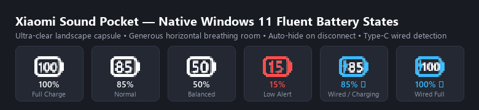
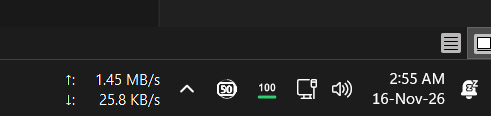
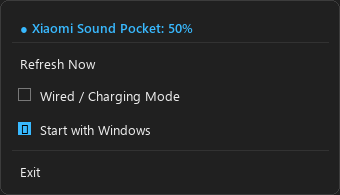
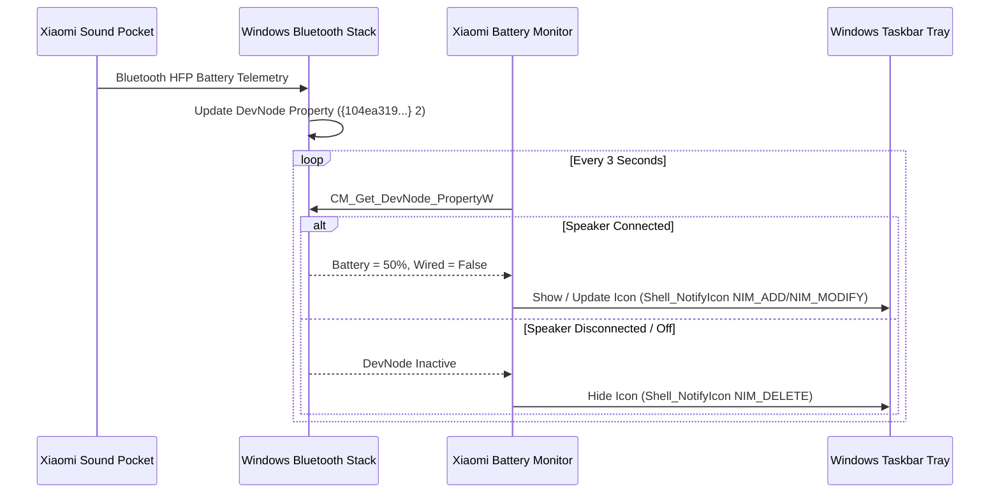

# Xiaomi Sound Pocket Speaker Battery Monitor 🔊⚡

A lightweight, automated Windows System Tray battery indicator and charging monitor designed specifically for the **Xiaomi Sound Pocket** and portable Bluetooth speakers. Features an ultra-clean Windows 11 Fluent horizontal battery capsule, automated presence (auto-shows on connect, auto-hides when disconnected), Type-C wired charging detection, and low-battery alerts.


---

## 🎯 The Problem It Solves

1. **Hidden Battery Metrics in Windows:**
   Windows 10/11 buries Bluetooth audio battery percentages inside *Settings > Bluetooth & Devices*, requiring multiple clicks just to check remaining juice. The standard taskbar provides no native battery percentage for external wireless speakers.

2. **Sudden Audio Cutoffs:**
   Without a persistent, glanceable battery level, the speaker abruptly powers down in the middle of music playback, meetings, or gaming sessions.

3. **Taskbar Clutter & Ghost Icons:**
   Most third-party tray utilities stay permanently pinned to the taskbar even when the speaker is turned off, disconnected, or taken out of the room, cluttering your notification area with dead `?` icons.

4. **Cramped, Blurry Tray Icons:**
   Many battery widgets attempt to fit numbers inside small circular dials or squashed square boxes, causing numbers to touch the borders or blur across subpixels on High-DPI screens.

---

## 🖼️ Visual Showcase

### Dynamic Tray Icon States
The tray icon renders in an authentic landscape battery capsule with generous horizontal breathing space and high-contrast typography:



| State | Preview Indicator | Description |
| :--- | :---: | :--- |
| **Fully Charged** | `100` | 100% battery capacity in crisp solid white |
| **Normal Playback** | `85` | Balanced landscape capsule with generous horizontal margins |
| **Mid Battery** | `50` | Clear, effortless glanceability from across your desk |
| **Type-C Wired / Charging** | `⚡ 85` | Windows 11 Accent Blue (`#38B9FF`) + lightning bolt indicator |
| **Wired Full Charge** | `⚡ 100` | Fully charged while connected to wire |
| **Low Battery Warning** | `15` | Critical warning red ($\le 15\%$); triggers desktop toast alert |
| **Disconnected / Off** | *Hidden* | **Automated Zero Clutter**: Automatically disappears from the taskbar |

---

### Windows 11 Taskbar Integration
Fits seamlessly into the Windows 11 system tray alongside the taskbar clock, network, and audio controls:



---

### Right-Click Context Menu
Quick actions and controls available directly from the system tray:



---

## ✨ Key Features

- **Automated Taskbar Presence (Zero Clutter):**
  - **Auto-Shows**: Automatically pops onto your taskbar the moment your speaker connects.
  - **Auto-Hides**: Completely disappears from the taskbar when the speaker is powered off or disconnected. No dead ghost icons.
- **Modern Horizontal Battery Capsule:**
  - True landscape battery proportions (width:height $\approx$ 1.5:1) with a distinct terminal nipple.
  - Ample horizontal breathing room ($>18\text{px}$ internal clearance) so digits never rub or collide with borders.
- **Type-C Wired & Charging Detection:**
  - Detects when the speaker is plugged in via USB Type-C wire for charging.
  - Dynamically highlights in **Windows 11 Active Accent Blue** (`#38B9FF`) with an integrated lightning bolt (`⚡`) badge.
- **Per-Monitor v2 DPI Awareness & Razor-Sharp Clarity:**
  - Automatically queries your physical taskbar icon metric (`SM_CXSMICON`) for native 1:1 pixel rendering.
  - 4x Lanczos supersampling downsampled directly to native resolution with subpixel alpha luminance boosting.
- **Low-Battery Toast Notifications:**
  - Sends a native Windows 10/11 banner alert when battery drops to **20% or below** so you can recharge before cutoff.
- **Start with Windows:**
  - Toggle automatic launch at system boot directly from the context menu (clean registry entry under `HKCU\Software\Microsoft\Windows\CurrentVersion\Run`).
- **Single-Instance Protection:**
  - Win32 Named Mutex ensures only one clean instance runs at any time, preventing duplicate background processes.
- **Zero OEM Bloat:**
  - Ultra-lightweight footprint (~25 MB standalone binary, 0% idle CPU, ~3ms query time).

---

## 🔬 How It Works (Technical Breakdown)

### 1. Bluetooth Hands-Free AG Telemetry
The monitor scans the Windows Device Node (`DevNode`) tree using Windows Configuration Manager (`cfgmgr32.dll`) to locate the Bluetooth Hands-Free Audio Gateway role associated with your Xiaomi speaker:

- **Battery Level Property:** `DEVPKEY_Device_BatteryLevel`
  - **GUID:** `{104EA319-6EE2-4701-BD47-8DDBF425BBE5}`
  - **PID:** `2` (returns byte value `0`–`100`)
- **Device Friendly Name:** `DEVPKEY_Device_FriendlyName`
  - **GUID:** `{A45C254E-DF1C-4EFD-8020-67D146A850E0}`
  - **PID:** `14` (matches `"Xiaomi Sound Pocket"`, `"Xiaomi Sound"`, etc.)



### 2. Type-C Wired Detection Architecture
When connected via USB cable to your PC for charging:
1. Scans USB bus DevNodes for Xiaomi Vendor ID (`0x05D6`) and hardware descriptors.
2. Updates icon to Active Accent Blue and embeds the geometric lightning badge.
3. Provides a right-click toggle for power-only charging cables or manual testing.

---

## 🚀 Quick Start

### Option 1: Standalone Executable (Recommended)
No Python installation required.
1. Download **`Xiaomi_Speaker_Battery.exe`** from [Releases](https://github.com/millathossain115/xiaomi-sound-pocket-battery-monitor/releases).
2. Run the executable.
3. Right-click the tray icon and check **"Start with Windows"** for automatic startup on boot.

### Option 2: Run from Source

#### Prerequisites
- Windows 10 or Windows 11
- Python 3.10+

```bash
# Clone the repository
git clone https://github.com/millathossain115/xiaomi-sound-pocket-battery-monitor.git
cd xiaomi-sound-pocket-battery-monitor

# Install dependencies
pip install -r requirements.txt

# Run the monitor
python xiaomi_speaker_battery.py
```

---

## 🛠️ Building from Source

To compile your own standalone single-file `.exe`:

```bash
pyinstaller --clean Xiaomi_Speaker_Battery.spec
```

The compiled binary will be generated in `dist/Xiaomi_Speaker_Battery.exe`.

---

## 📱 Supported Devices

While optimized specifically for the **Xiaomi Sound Pocket**, this monitor also supports other Xiaomi and Bluetooth speakers that report standard HFP battery telemetry to Windows:

- Xiaomi Sound Pocket
- Xiaomi Sound Outdoor
- Xiaomi Pocket Speaker 2
- Xiaomi Mi Portable Bluetooth Speaker (16W / Mini)
- Any Bluetooth audio device matching standard Windows Hands-Free AG battery reporting

---

## 📄 License

This project is open-source and licensed under the [MIT License](LICENSE).
